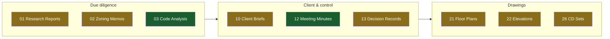

# Markdown ergonomics: making dense studio docs scannable in VS Code

Date: 2026-10-09
Scope: how Tyler (and staff) read dense Markdown - the Reference Sets README today,
SET.md cards, HOW-TO, plan docs - and the format + tooling changes that make them
immediate instead of tedious.
Trigger: Tyler, opening the 27-set Reference Sets folder and README: "impossible to
read the tables and quickly understand what's going on and how I'm supposed to
interact with this."

## What the research says (sources at the bottom)

1. **VS Code renders Mermaid natively since 1.121 (2026-05)** - Markdown preview,
   notebooks, chat; pan/zoom controls built in. No extension needed; the old
   bierner `markdown-mermaid` extension is deprecated/merged, and the
   `mermaid-chart` extension conflicts with the built-in - uninstall duplicates.
   (code.visualstudio.com/updates/v1_121)
2. **`<details>/<summary>` collapsible sections** render in VS Code preview and
   GitHub - the legal way to hide depth until asked. (GitHub docs)
3. **Mermaid `click` links are unreliable** across renderers (securityLevel
   restrictions; GitHub blocks them). Never make navigation depend on a clickable
   node - put a text link beside every diagram node. (github.com/orgs/community
   discussion 46096)
4. **Mindmaps are marked experimental** in Mermaid; flowcharts are the durable
   primitive. Use `flowchart LR` with `subgraph` per band.
5. **Drive web preview shows Mermaid as raw code.** Progressive enhancement is
   mandatory: the text must stand alone; the diagram is a layer on top, never the
   only carrier of a distinction (same rule as ADR 0008's colour rule).
6. **The README's unreadability is structural, not cosmetic**: one 8-column table
   whose Exemplars cells run 200+ characters. No renderer fixes that; the
   information design has to change.

## The redesign (Reference Sets README as the pilot)

**Above the fold, a visual map** - one `flowchart LR`, one subgraph per lifecycle
band, one short node per set, status as a classDef colour PLUS a word (never colour
alone):



Then a **"How to use this" 3-line strip** (open card → open 1-2 nearest exemplars →
never start from an exemplar) - the interaction model he asked for, in the first
screen.

Then **one small table per band**, three columns only:

```markdown
### Due diligence
| Set | Status | Card |
|---|---|---|
| 01 Research Reports | candidate | [SET.md](01%20Research%20Reports/SET.md) |
```

Exemplar detail drops out of the README - it duplicates what every card's "The
exemplars" table already says. The README answers three questions: what exists, is
it approved, where do I click. Everything else is one click in.

Long per-band history/caveats fold into `<details>` blocks.

## Implementation plan

### Phase 0 - Tyler's machine (10 min)

| # | Work | Done when |
|---|---|---|
| 0.1 | VS Code >= 1.121; uninstall `bierner.markdown-mermaid` and any `mermaid-chart` extension (they conflict with the built-in) | Mermaid block renders in preview with pan/zoom |
| 0.2 | Optional: Markdown All in One (TOC, `Ctrl+Shift+O` outline) | - |
| 0.3 | Habit, not software: preview side-by-side (`Ctrl+K V`), navigate by Outline view | - |

### Phase 1 - House convention (half a day, repo)

New rule file `rules/visual-markdown.md`, linked from `rules/README.md`:

- Mermaid allowed in any doc; **the words must stand alone** (Drive web preview
  shows the raw block). Every diagram restates text that is present, never adds
  information.
- `flowchart` only (mindmap is experimental); one diagram per file unless the file
  is a map by job; node labels under ~25 chars.
- No `click` links - a text link beside the diagram instead.
- `<details>` for depth; status/severity as words, colour may reinforce.
- Cards keep the 150-line cap - a diagram must earn its lines.

### Phase 2 - README redesign + generator (Atlas 0.15.0)

| # | Work | Files | Done when |
|---|---|---|---|
| 2.1 | `atlas refs index` emits the new shape: mermaid map (bands from folder prefix ranges: 0x due diligence, 1x client/control/permitting, 19-2x drawings, 4x construction, 9x control files), 3-column banded tables | `core/refsets.py`, tests | Byte-idempotent regenerate; renders in VS Code preview |
| 2.2 | Band model in the generator is data-driven (prefix ranges as a table in code; the map could carry them later - not now) | same | New band = one-line edit |
| 2.3 | Apply to the real README; the hand parts (how-to-use strip, version table) stay outside the markers | drive | `refs index` then reports "up to date" |
| 2.4 | `refs doctor` unchanged and clean | - | 0 problems |
| 2.5 | `uv run pytest` green; release 0.15.0; deploy | tools/atlas | deployed |

### Phase 3 - SET.md card ergonomics (one pass, 27 cards)

- A 3-line top strip per card: **Use when** / **Start from** / **Never** - the
  interaction answer before the scroll.
- No diagrams in cards by default (the cap); add one only where a workflow exists
  (e.g. the sheet-check order on drawing cards when Pyvoid ships).
- Cards stay agent-first; the strip serves both readers.

### Phase 4 - Rollout, measured

- HOW-TO.md gets the same treatment (it is the staff-facing peer): visual map of
  the bat launchers, banded sections.
- Plan docs and PROJECT.md templates: convention only, no retrofit unless Tyler
  asks while reading one.
- Measure: Tyler opens the README once and says whether the question "what exists,
  what's approved, where do I click" answers in under 10 seconds. If not, iterate
  on the map, not the tables.

### Deferred (with reasons)

- **Generated HTML gallery** - a second surface to maintain; VS Code preview covers
  the need. Revisit if staff without VS Code need browse access (Drive web).
- **Clickable Mermaid nodes** - unreliable across renderers (finding 3).
- **Markdown Preview Enhanced** - native preview now covers Mermaid; MPE adds TOC
  and export but is a heavier, slower renderer. Optional install, not a dependency.

## Risks

| Risk | Mitigation |
|---|---|
| Diagram and table drift apart | Both generated from the same card front matter by `atlas refs index` - one source |
| Mermaid syntax error breaks the preview silently | `refs doctor` gains a "mermaid block parses" check (mermaid.ink or a syntax lint in tests) in Phase 2 |
| Staff on Drive web see raw code | Progressive-enhancement rule (finding 5); tables carry everything |
| Colour-only status in the diagram | Word in the table + classDef in the diagram; never one without the other |

## Sources

- VS Code 1.121 release notes (native Mermaid): https://code.visualstudio.com/updates/v1_121
- bierner markdown-mermaid (deprecated, merged into core): https://marketplace.visualstudio.com/items?itemName=bierner.markdown-mermaid
- mermaid-chart extension conflict: https://github.com/Mermaid-Chart/vscode-mermaid-chart/issues/126
- Mermaid mindmap (experimental): https://mermaid.ai/open-source/syntax/mindmap.html
- Mermaid click restrictions: https://github.com/orgs/community/discussions/46096
- Collapsed sections: https://docs.github.com/en/get-started/writing-on-github/working-with-advanced-formatting/organizing-information-with-collapsed-sections
- Markdown All in One: https://marketplace.visualstudio.com/items?itemName=yzhang.markdown-all-in-one
